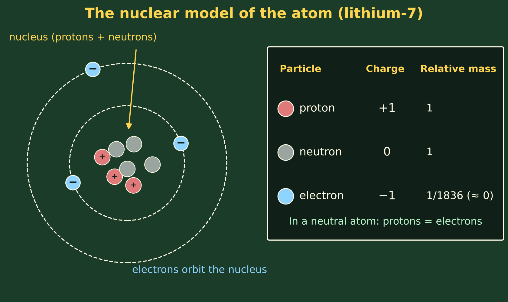
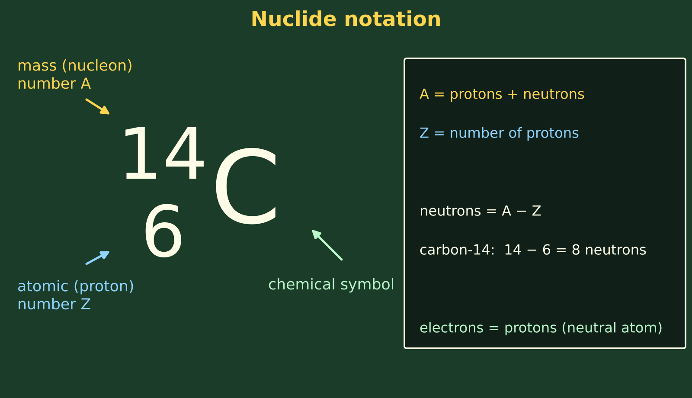
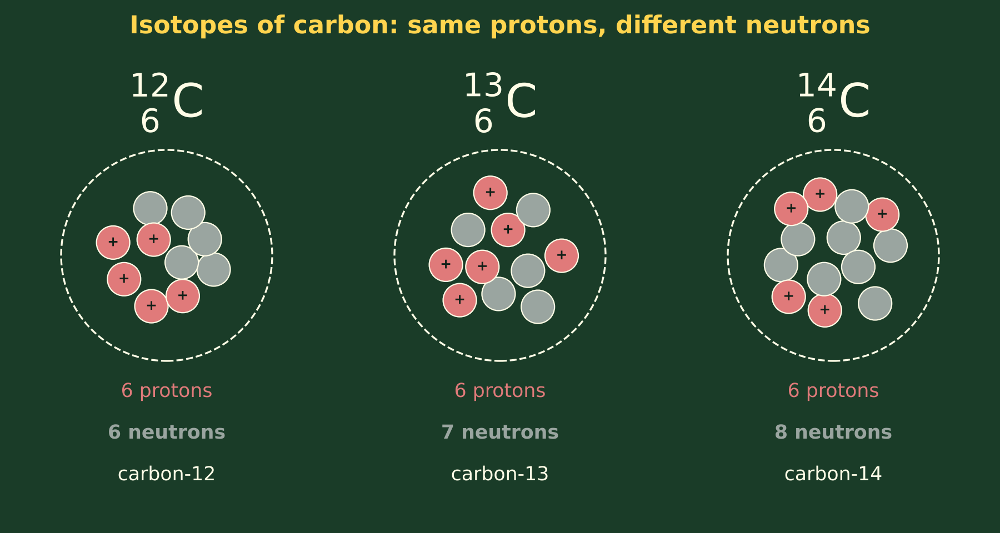

### Units (8.1)

Activity is measured in **becquerels (Bq)**: 1 Bq = one nucleus decaying per second. Half-lives and times use **seconds (s), minutes (min) and hours (h)**; thickness and distance use **centimetres (cm)**. Always convert to the same time unit before you divide a time by a half-life.

### Structure of the atom (8.2)

An atom has a tiny, dense **nucleus** containing **protons** and **neutrons** (together called nucleons), with **electrons** orbiting around it. The atom is neutral because the number of electrons equals the number of protons.

| **Particle** | **Relative charge** | **Relative mass** | **Where** |
| --- | --- | --- | --- |
| Proton | +1 | 1 | nucleus |
| Neutron | 0 | 1 | nucleus |
| Electron | −1 | very small (about 1/2000) | orbiting the nucleus |

*Figure 1: the structure of an atom*

### Nuclide notation and isotopes (8.2, 8.3)

A nucleus is written **ᴬ\_Z X**. The **mass (nucleon) number A** is the number of protons plus neutrons. The **atomic (proton) number Z** is the number of protons. So **neutrons = A − Z**. For example ¹⁴₆C has 6 protons and 14 − 6 = 8 neutrons.

*Figure 2: nuclide notation — what A and Z tell you*

**Isotopes** are atoms of the same element (same Z) with **different numbers of neutrons** (different A). They have the same chemical properties. Some isotopes are unstable and radioactive.

*Figure 3: isotopes of carbon*

Key facts

Z = protons = electrons (neutral atom). A = protons + neutrons. Neutrons = A − Z.Isotopes: same Z, different A (different number of neutrons).1 Bq = 1 decay per second.

Common Mistakes

Mixing up A and Z: A is the bigger (top) number.Saying isotopes have different numbers of protons. They have the same number of protons.Forgetting that the electrons are not in the nucleus.

