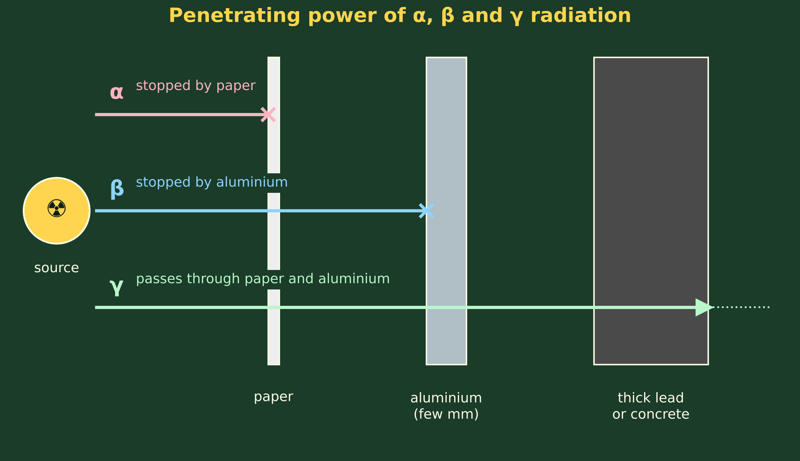
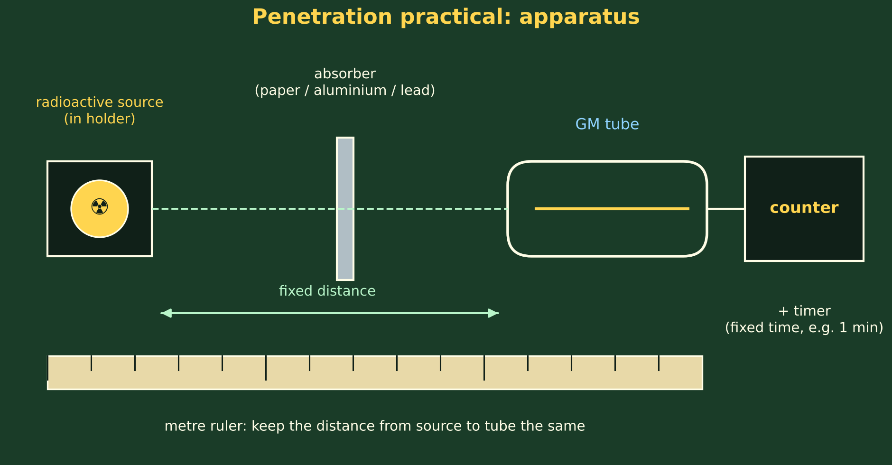
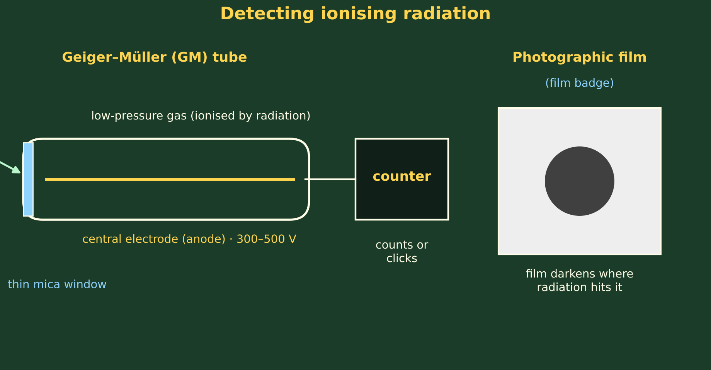
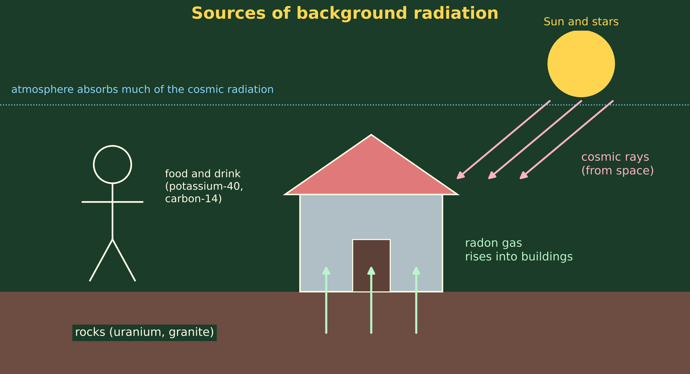

### Alpha, beta and gamma (8.4, 8.5)

Unstable nuclei emit radiation in a **random process**: we cannot predict when a particular nucleus will decay, only the chance of it happening. The three radiations are **ionising** — they knock electrons off atoms, creating ions.

|   | **Alpha (α)** | **Beta (β⁻)** | **Gamma (γ)** |
| --- | --- | --- | --- |
| What it is | helium nucleus: 2 protons + 2 neutrons | a fast electron from the nucleus | electromagnetic wave (no mass) |
| Charge | +2 | −1 | 0 |
| Ionising ability | strongest | medium | weakest |
| Penetration | stopped by paper (a few cm of air) | stopped by a few mm of aluminium | reduced by thick lead or concrete |

*Figure 4: penetrating power of α, β and γ*

There is a trade-off: the radiation that ionises most (alpha) penetrates least, and the radiation that penetrates most (gamma) ionises least.

### Required practical — penetration (8.6)

- Set up the **source**, an **absorber** and a **Geiger–Müller (GM) tube** with a counter, with a fixed distance between source and tube (measure it with a ruler).
- First measure the **background count** with the source far away, in a fixed time.
- Count for a **fixed time** with no absorber, then with paper, aluminium and lead in turn, keeping the same distance and time.
- **Subtract the background** from each count, then compare. A big fall means that material absorbs that radiation.
- Safety: handle the source with tongs, never point it at anyone, keep it in its holder when not in use.

*Figure 5: apparatus for the penetration practical*

### Detecting radiation (8.9)

**Photographic film** is fogged (darkened) by ionising radiation, so film badges show how much radiation workers have received. A **Geiger–Müller (GM) tube** has a thin mica window; radiation entering ionises the low-pressure gas, producing a pulse of current that the counter registers (often as a click).

*Figure 7: photographic film and the GM tube*

### Background radiation (8.10)

**Background radiation** is always present. From the **Earth**: radon gas from rocks (especially granite) which collects in buildings, rocks and soil, building materials, and food and drink (e.g. potassium-40). From **space**: **cosmic rays** from the Sun and stars; the atmosphere absorbs much of it. A small part is man-made, such as medical equipment. **Always subtract the background count from experimental counts.**

*Figure 8: sources of background radiation*

Key facts

α: helium nucleus, +2, most ionising, stopped by paper. β⁻: electron, −1, stopped by a few mm of aluminium. γ: EM wave, weakest ionising, most penetrating.Decay is random. Measure with film (fogging) or a GM tube (counts).Penetration practical: same distance, same time, subtract background.Background: radon and rocks, food, cosmic rays, medical sources.

Common Mistakes

Saying beta is stopped by paper, or alpha by aluminium. Order: paper (α) &lt; aluminium (β) &lt; lead/concrete (γ).Forgetting the background count in the method.Saying gamma is a particle. It is an electromagnetic wave.

