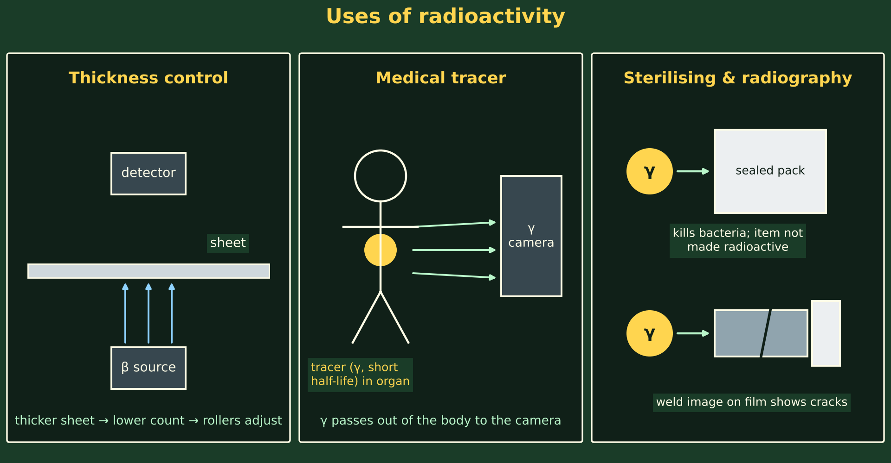
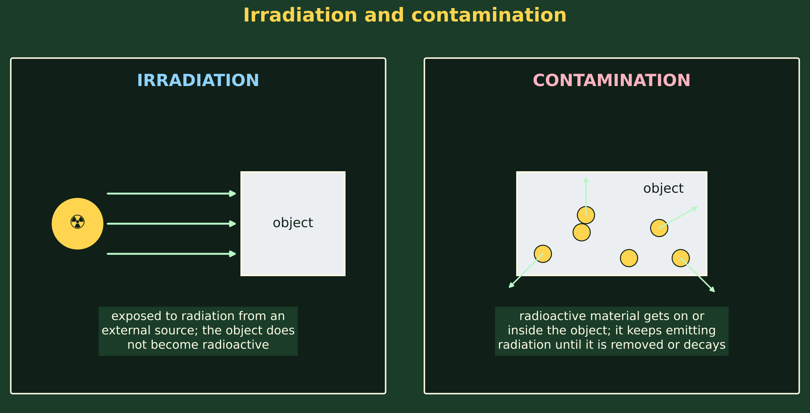
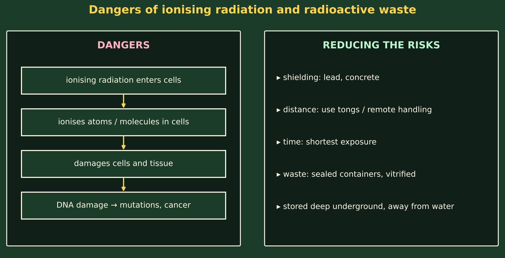

### Uses of radioactivity (8.14)

| **Use** | **Radiation** | **Why that choice** |
| --- | --- | --- |
| Medical tracer (I-123, Tc-99m) | gamma | passes out of the body to the camera; short half-life limits the dose |
| Treating cancer (I-131, Y-90) | beta (or alpha) | short range: kills nearby cancer cells; less damage to healthy tissue |
| Sterilising instruments and food | gamma | penetrates packaging and kills bacteria; item does not become radioactive |
| Thickness control (paper, foil) | beta | partly absorbed: count changes with thickness; alpha stopped, gamma passes through |
| Checking welds / castings | gamma | penetrates metal; cracks show on film |

*Figure 13: uses of radioactivity*

### Irradiation and contamination (8.15)

**Irradiation:** exposed to radiation from a source outside the object; the object does **not** become radioactive. **Contamination:** radioactive material gets **on or inside** the object or person, which keeps emitting radiation until it is removed or decays.

*Figure 14: irradiation versus contamination*

### Dangers and waste (8.16)

Ionising radiation **damages cells and tissue** and can cause **mutations** (possibly cancer). To reduce the risk: **shielding** (lead, concrete), **distance** (tongs, remote handling), **short exposure time**, and film badges to monitor the dose. **Waste** stays radioactive for a very long time (long half-lives). Reduce the risk by storing it in **sealed lead or concrete containers**, vitrifying it (setting it in glass) and burying it deep underground in places with low geological activity and away from groundwater.

*Figure 15: dangers of radiation and how to reduce the risks*

Key facts

Common Mistakes

Saying an irradiated object becomes radioactive.Giving alpha as a medical tracer (it cannot leave the body).Naming a use without saying why that radiation or half-life suits it.

