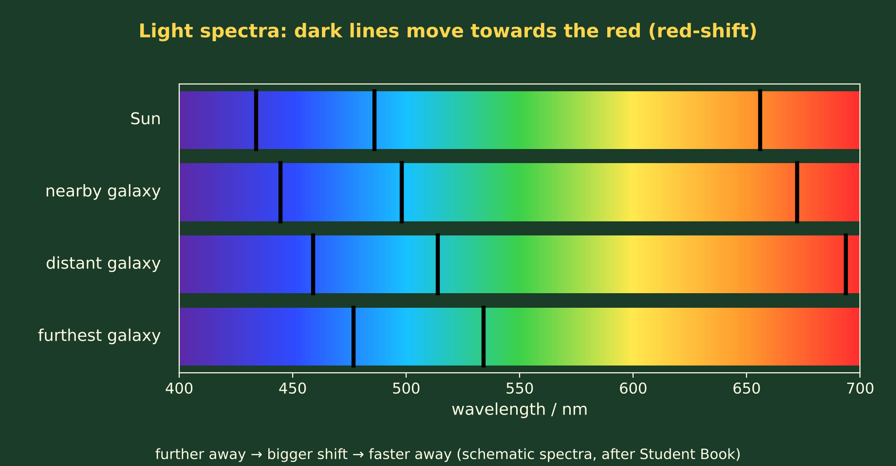
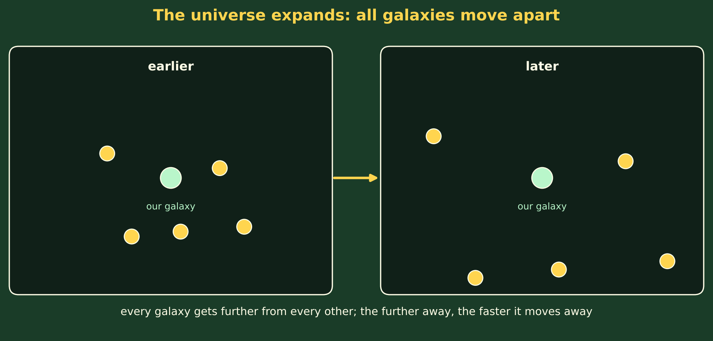

### The red-shift equation (9.16P)

Atoms give out light of a known **reference wavelength λ₀**. From a galaxy moving away, the same line arrives at a longer wavelength λ. The **change in wavelength** is Δλ = λ − λ₀, and **Δλ ÷ λ₀ = v ÷ c**, where v is the galaxy’s speed and c = 3.0 × 10⁸ m/s.

*Figure 16: lines move towards the red for galaxies that are further away*

| **Level** | **Question** | **Full working (write it all on the board)** | **Answer** |
| --- | --- | --- | --- |
| Easy | A line of 434 nm is measured as 482 nm. Find v. | Δλ = 48 nm;  v = c × Δλ ÷ λ₀ = 3.0 × 10⁸ × 48 ÷ 434 | 3.3 × 10⁷ m/s |
| Medium | Δλ = 300 nm, λ₀ = 600 nm. Find v. | Δλ ÷ λ₀ = 0.5;  v = 0.5 × 3.0 × 10⁸ | 1.5 × 10⁸ m/s |
| Hard | J25 1P Q10(b): v = 1.44 × 10⁵ m/s, λ₀ = 4.3405 × 10⁻⁷ m. Find λ (5 s.f.). | Δλ = 4.3405 × 10⁻⁷ × 1.44 × 10⁵ ÷ 3.00 × 10⁸ = 2.0834 × 10⁻¹⁰;  λ = λ₀ + Δλ | 4.3426 × 10⁻⁷ m |

### Red-shift, distance and expansion (9.17P, 9.18P)

Almost all galaxies show **red-shift**, so they are moving **away**. **The further away a galaxy, the greater its red-shift**, so the faster it is moving away. If all galaxies move apart and the further ones move faster, **space itself is expanding**. This is **evidence that the universe is expanding**, as the Big Bang theory says.

*Figure 17: as space expands, all galaxies move further apart*

Key facts

Δλ = λ − λ₀ and Δλ ÷ λ₀ = v ÷ c.Greater red-shift → faster, further galaxy.Red-shift of galaxies is evidence that the universe is expanding.J25 1PR Q8(c): most galaxies show red-shift (moving away); further galaxies show greater red-shift and move faster; all matter came from a single point.

Common Mistakes

Using λ instead of Δλ in the equation.Mixing nm and m inside one calculation.Saying red-shift makes a galaxy move faster — the galaxy’s speed causes the red-shift.Rounding to 4.34 × 10⁻⁷ when the question asks for five significant figures.

Exam Tips

Orbit calculations: convert to m and s first, then v = 2πr ÷ T; give the answer in standard form.Life-cycle questions: ‘larger than the Sun’ → red supergiant, supernova, neutron star.‘Two pieces of evidence for the Big Bang’: CMB radiation and red-shift of galaxies.Write Δλ/λ₀ = v/c first in every red-shift calculation.

