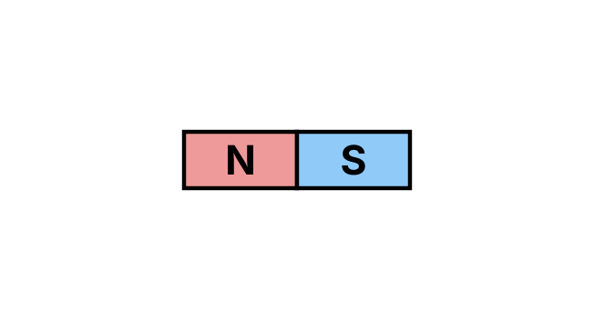
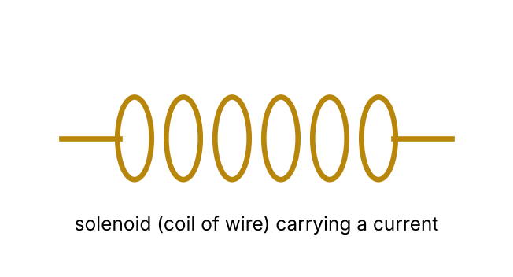

## Magnets and Magnetic Fields

spec 7.1–7.7 · 19 marks

**Q1 F spec 7.2 · 2 marks**

Two bar magnets are held close together.

(a) State what happens when two north poles are brought together. [1]

(b) State what happens when a north pole and a south pole are brought together. [1]

**Q2 F spec 7.3 · 3 marks**

Steel is used to make permanent magnets. Soft iron is used for the core of an electromagnet.

Explain why each material is used. [3]

**Q3 F spec 7.4 · 3 marks**

Draw four field lines around the bar magnet. Show their direction with arrows. [3]

**Bar magnet — draw your field lines around it**

**Q4 C spec 7.5 · 3 marks**

A steel paper clip is placed near the north pole of a bar magnet and is attracted to it.

Explain why the paper clip is attracted. [3]

**Q5 C spec 7.6 · 4 marks**

Describe how to use a plotting compass to plot the magnetic field around a bar magnet. [4]

**Q6 E spec 7.7 · 4 marks**

(a) Describe what is meant by a uniform magnetic field. [2]

(b) Describe how two permanent magnets can be used to produce a uniform field. [2]

## Currents and Magnetic Fields

spec 7.8–7.10P · 17 marks

**Q7 F spec 7.8 · 3 marks**

A current flows in a straight wire.

(a) State what is produced around the wire. [1]

(b) Describe the shape of the field pattern. [2]

**Q8 F spec 7.9P · 3 marks**

State three ways to make an electromagnet stronger. [3]

**Q9 C spec 7.10P · 3 marks**

Draw the magnetic field pattern of a solenoid carrying a current. [3]

**Solenoid — draw the field pattern**

**Q10 C spec 7.9P · 4 marks**

A student makes an electromagnet by winding insulated copper wire around an iron nail and connecting it to a cell.

(a) Suggest two changes that make it pick up more paper clips. [2]

(b) Explain why a nail made of iron is better than one made of steel. [1]

(c) Explain why the wire must be insulated. [1]

**Q11 E spec 7.8–7.10P · 4 marks**

Explain why the magnetic field inside a solenoid is stronger than the field near a single straight wire carrying the same current. [4]

## Forces: Wires, Charges, Motors, Loudspeakers

spec 7.11P–7.14 · 20 marks

**Q12 F spec 7.11P · 2 marks**

A charged particle moves through a magnetic field.

(a) State the direction of motion for which there is no force on the particle. [1]

(b) State the direction of the force when there is one. [1]

**Q13 F spec 7.13 · 3 marks**

State what each part of the left hand shows in Fleming’s left-hand rule:

(a) first finger [1]   (b) second finger [1]   (c) thumb [1]

**Q14 C spec 7.13–7.14 · 4 marks**

A wire carries a current into the page between the N pole (left) and the S pole (right) of two magnets.

(a) State the direction of the force on the wire. [1]

(b) Describe how you used the left-hand rule. [1]

(c) State two ways to reverse the force. [2]

**Q15 C spec 7.14 · 3 marks**

(a) State two ways to increase the force on a current-carrying wire in a magnetic field. [2]

(b) State the force when the wire is parallel to the field. [1]

**Q16 C spec 7.12 · 4 marks**

Describe how a simple d.c. motor keeps turning in the same direction. [4]

**Q17 E spec 7.12 · 4 marks**

Explain how a loudspeaker produces sound. [4]

## Induction and Generators

spec 7.15–7.16 · 12 marks

**Q18 F spec 7.15 · 3 marks**

A magnet is pushed into a coil connected to a sensitive voltmeter. State the voltmeter reading when:

(a) the magnet moves into the coil [1]

(b) the magnet is held still inside the coil [1]

(c) the magnet is pulled out of the coil [1]

**Q19 F spec 7.15 · 3 marks**

State three ways to increase the voltage induced in a coil. [3]

**Q20 C spec 7.16 · 3 marks**

Explain why the output voltage from a simple generator is alternating. [3]

**Q21 E spec 7.16 · 3 marks**

The coil of a generator is turned at twice the speed.

(a) State two changes to the voltage–time graph. [2]

(b) State the purpose of the slip rings. [1]

## Transformers and the National Grid

spec 7.17P–7.20P · 29 marks

**Q22 F spec 7.17P · 3 marks**

Name the three main parts of a transformer. [3]

**Q23 C spec 7.17P · 5 marks**

(a) Explain how a transformer changes the size of an alternating voltage. [3]

(b) Explain why a transformer does not work with a d.c. supply. [2]

**Q24 C spec 7.19P · 4 marks**

A transformer has 920 turns on the primary coil and 48 turns on the secondary coil. The primary voltage is 230 V.

(a) State the equation linking voltages and turns. [1]

(b) Calculate the secondary voltage. [2]

(c) State whether the transformer is step-up or step-down. [1]

**Q25 E spec 7.20P · 3 marks**

A transformer is 100% efficient. The primary voltage is 230 V. The secondary voltage is 11.5 V and the secondary current is 4.0 A.

Calculate the primary current. [3]

**Q26 C spec 7.18P · 4 marks**

Explain why electrical energy is transmitted across the country at very high voltage. [4]

**Q27 E spec 7.19P–7.20P · 7 marks**

A phone charger contains a step-down transformer. Mains voltage is 230 V, the output is 5.0 V and the number of turns on the primary coil is 4600. Assume the transformer is 100% efficient. The charger delivers 2.0 A.

(a) Calculate the number of turns on the secondary coil. [3]

(b) Calculate the output power. [2]

(c) Calculate the current in the primary coil. [2]

**Q28 E spec 7.18P–7.20P · 3 marks**

A student says: “A step-up transformer gives out more energy than it takes in, because the output voltage is bigger.”

Comment on this statement. [3]

Show all mark schemes

Each line is one mark. “/” means either answer is accepted.

### Section A · Magnets and magnetic fields

| **Q** | **Mark points (1 mark each)** | **Marks** | **Examiner note** |
| --- | --- | --- | --- |
| 1 | ✔ (a) they repel / push apart ✔ (b) they attract / pull together | 2 | Use the words repel and attract. “They stick” or “they push” alone is not precise enough. |
| 2 | ✔ steel is magnetically hard / keeps its magnetism ✔ soft iron is magnetically soft / easily magnetised and demagnetised ✔ (so) an electromagnet can be switched off (when the current stops) | 3 | The third mark is the reason the property matters. Say what the core must do, not only what iron is. |
| 3 | ✔ lines leave the N pole and enter the S pole (loops from pole to pole) ✔ arrows point from N to S outside the magnet ✔ four lines, smooth, not touching or crossing | 3 | Lines closer together at the poles earn the mark for shape when asked for strength. Never let lines cross. |
| 4 | ✔ steel is a magnetic material ✔ the paper clip becomes magnetised / an induced magnet in the field of the magnet ✔ the end nearest the N pole becomes a S pole, so there is attraction | 3 | Key phrase: induced magnet. Many students write “the magnet attracts all metals”, which is wrong. |
| 5 | ✔ place the magnet on paper and the compass near one pole ✔ mark the positions of both ends of the compass needle with dots ✔ move the compass so its tail is on the last dot and repeat ✔ join the dots to make a field line; arrow from N to S | 4 | Number your steps. Say that the needle tail moves to the previous dot — this is the idea examiners credit. |
| 6 | ✔ (a) field lines are parallel ✔ (a) and equally spaced / same strength and direction everywhere ✔ (b) place a N pole facing a S pole (opposite poles facing) ✔ (b) with a small gap and flat faces / close together | 4 |  |

### Section B · Currents and magnetic fields

| **Q** | **Mark points (1 mark each)** | **Marks** | **Examiner note** |
| --- | --- | --- | --- |
| 7 | ✔ (a) a magnetic field ✔ (b) concentric circles around the wire ✔ (b) closer together near the wire (weaker further away) | 3 |  |
| 8 | ✔ increase the current ✔ add more turns to the coil ✔ put a (soft) iron core inside the coil | 3 | Do not say “bigger battery” — it must be a bigger current. Using more coils of wire = more turns. |
| 9 | ✔ straight, parallel lines inside the solenoid (strong, uniform field) ✔ closed loops outside, from one end to the other ✔ pattern like that of a bar magnet | 3 | The right-hand grip rule is NOT in the Issue 2 spec, so you are not asked to label poles from the current direction. |
| 10 | ✔ (a) increase the current / more cells ✔ (a) more turns on the coil ✔ (b) iron is magnetically soft, so the clips drop when the current is switched off ✔ (c) so the current goes round every turn and does not short-circuit through the nail / touching turns | 4 | In (a) two different changes are needed — “more turns” twice scores once. |
| 11 | ✔ a solenoid is a coil with many turns ✔ each turn produces its own magnetic field ✔ the fields from all the turns add together inside the coil ✔ the field lines are concentrated (close together), so the field is stronger | 4 | A good 4-mark answer links cause (many turns) to effect (fields add) to result (lines close together). |

### Section C · Forces: wires, charges, motors, loudspeakers

| **Q** | **Mark points (1 mark each)** | **Marks** | **Examiner note** |
| --- | --- | --- | --- |
| 12 | ✔ (a) parallel to the field ✔ (b) at right angles to the field (and to the motion) | 2 |  |
| 13 | ✔ (a) the magnetic field (N to S) ✔ (b) the current (+ to −) ✔ (c) the force / motion | 3 | Learn FBI: Force (thumb), B-field (first finger), I current (second finger). |
| 14 | ✔ (a) downwards (down the page) ✔ (b) first finger to the right (field N→S), second finger into the page (current), thumb gives the force ✔ (c) reverse the current ✔ (c) reverse the magnetic field (swap the magnets); not both | 4 | Reversing both current and field together leaves the force unchanged — a favourite trap. |
| 15 | ✔ (a) increase the current ✔ (a) use a stronger magnet (stronger field) ✔ (b) zero / no force | 3 | The force is largest at right angles to the field and zero when parallel. |
| 16 | ✔ the current is in opposite directions on opposite sides of the coil ✔ so the forces on the two sides are opposite and the coil turns ✔ a split-ring commutator reverses the current every half turn ✔ so the forces keep turning the coil the same way | 4 | Say the current reverses, not the magnetic field. The commutator is the key word. |
| 17 | ✔ an alternating current flows in the coil ✔ the coil is in the field of a permanent magnet, so there is a force on the coil ✔ the current changes direction, so the force changes direction (the coil vibrates) ✔ the cone vibrates and makes the air vibrate (sound waves) | 4 | Use the sequence current → force → vibrate → sound. a.c. is essential: d.c. would push the cone out and hold it there. |

### Section D · Induction and generators

| **Q** | **Mark points (1 mark each)** | **Marks** | **Examiner note** |
| --- | --- | --- | --- |
| 18 | ✔ (a) a (small) voltage / deflection ✔ (b) zero ✔ (c) a voltage in the opposite direction | 3 | No relative movement means no induced voltage. This is the single most examined idea. |
| 19 | ✔ move the magnet (or coil) faster ✔ use a stronger magnet ✔ use more turns on the coil | 3 | “Bigger coil” is not accepted unless it means more turns. |
| 20 | ✔ the coil rotates in the magnetic field and cuts the field lines ✔ each side moves up and then down through the field, so the direction of cutting reverses every half turn ✔ so the induced voltage reverses direction | 3 | The word reverses must appear. A generator is a motor in reverse: it needs movement. |
| 21 | ✔ (a) the peak voltage is larger (doubled) ✔ (a) the frequency doubles / the period halves (more cycles per second) ✔ (b) keep the rotating coil connected to the external circuit | 3 | Speed affects BOTH height and frequency of the graph. |

### Section E · Transformers and the national grid

| **Q** | **Mark points (1 mark each)** | **Marks** | **Examiner note** |
| --- | --- | --- | --- |
| 22 | ✔ primary coil ✔ secondary coil ✔ (soft) iron core | 3 | The core is soft iron so it carries the changing field and loses its magnetism easily. |
| 23 | ✔ (a) a.c. in the primary coil produces a changing magnetic field in the core ✔ (a) the changing field passes through the secondary coil ✔ (a) so a voltage is induced in the secondary (the number of turns sets its size) ✔ (b) d.c. gives a constant magnetic field ✔ (b) so there is no change of field and no voltage is induced | 5 |  |
| 24 | ✔ (a) Vp ÷ Vs = Np ÷ Ns ✔ (b) substitution: 230 ÷ Vs = 920 ÷ 48 (or Vs = 230 × 48 ÷ 920) ✔ (b) Vs = 12 V ✔ (c) step-down (fewer turns on the secondary) | 4 | Show the rearrangement. Marks are for the method, so write the substitution even if you slip on the arithmetic. |
| 25 | ✔ Vp Ip = Vs Is (correct equation used) ✔ 230 × Ip = 11.5 × 4.0 (substitution) ✔ Ip = 0.20 A | 3 |  |
| 26 | ✔ power = voltage × current (P = VI) ✔ for the same power, a higher voltage means a lower current ✔ a lower current means less heating of the cables ✔ so less energy is wasted (more efficient transmission) | 4 | Use P = VI — no I²R is needed. Link: high V → low I → less heat → less energy lost. |
| 27 | ✔ (a) Vp ÷ Vs = Np ÷ Ns ✔ (a) 230 ÷ 5.0 = 4600 ÷ Ns ✔ (a) Ns = 100 turns ✔ (b) P = V × I = 5.0 × 2.0 ✔ (b) P = 10 W ✔ (c) Ip = P ÷ Vp = 10 ÷ 230 ✔ (c) Ip = 0.043 A | 7 | Part (c) can also use VpIp = VsIs. Output power = input power for 100% efficiency. |
| 28 | ✔ the output voltage is larger (so the statement is half-right) ✔ but the output current is smaller ✔ energy / power out cannot be greater than energy in (conservation of energy); the statement is incorrect | 3 | “Comment” = give a balanced judgement. Say what is right, what is wrong, and give the verdict. |

